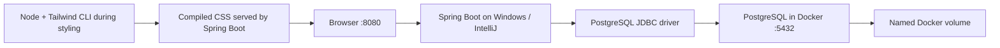
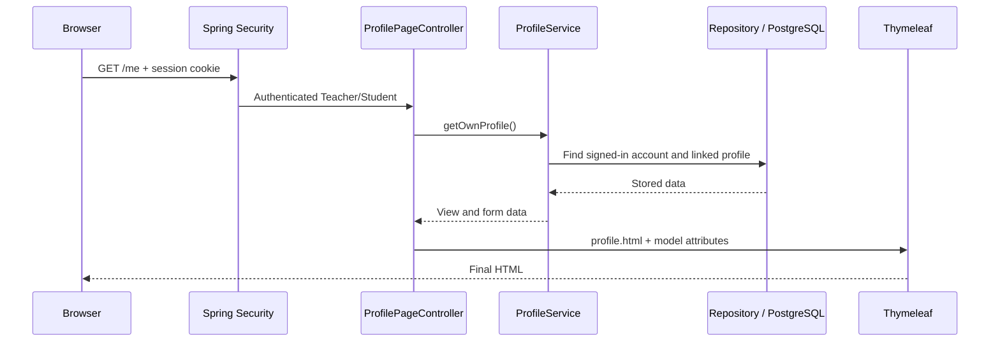
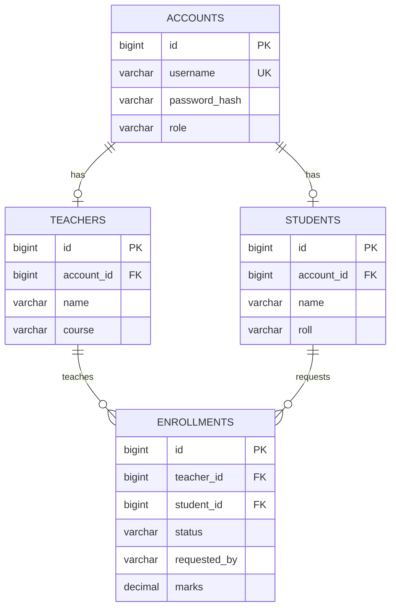
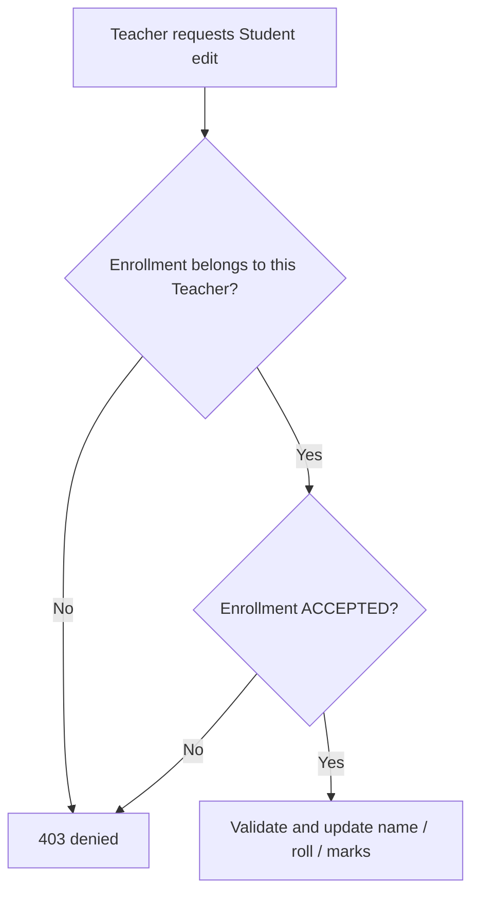

# FM School: complete setup, code, demonstration and editing guide

Updated: 26 October 2026. This guide describes the code currently in this repository.

**Read sections 1–5 to run the project; 6–11 to understand it; 12–15 to make changes; 16–19 to prepare for the lab.** You do not need to memorize every line. Learn the request flow and use the file map to locate the relevant code.

## Contents

1. [What we built and the final rules](#1-what-we-built-and-the-final-rules)
2. [Tools and what runs where](#2-tools-and-what-runs-where)
3. [Set up another Windows PC](#3-set-up-another-windows-pc)
4. [Accounts and demo data](#4-accounts-and-demo-data)
5. [Everyday startup, shutdown and Git](#5-everyday-startup-shutdown-and-git)
6. [Understand one complete request](#6-understand-one-complete-request)
7. [Find the code that does the work](#7-find-the-code-that-does-the-work)
8. [Database structure and migrations](#8-database-structure-and-migrations)
9. [Login, permissions and ownership](#9-login-permissions-and-ownership)
10. [DTOs, validation and transactions](#10-dtos-validation-and-transactions)
11. [Thymeleaf and compiled Tailwind](#11-thymeleaf-and-compiled-tailwind)
12. [A safe method for changing anything](#12-a-safe-method-for-changing-anything)
13. [Common teacher requests: exact editing recipes](#13-common-teacher-requests-exact-editing-recipes)
14. [Worked example: add a Student phone field](#14-worked-example-add-a-student-phone-field)
15. [Tests and Postman](#15-tests-and-postman)
16. [Step-by-step demonstration](#16-step-by-step-demonstration)
17. [Troubleshooting](#17-troubleshooting)
18. [Questions you should be able to answer](#18-questions-you-should-be-able-to-answer)
19. [Limitations and final checklist](#19-limitations-and-final-checklist)

## 1. What we built and the final rules

FM School manages accounts, personal profiles, courses, enrollment requests and marks.

| User | Can do |
|---|---|
| Admin | Manage Teachers and Students; create/edit/delete their accounts and profiles; manage all enrollments and marks |
| Teacher | Sign up/login; edit/delete their own profile/account; invite Students; accept/reject incoming applications; remove accepted associations; edit the name, roll and marks of their accepted Students |
| Student | Sign up/login; edit/delete their own profile/account; apply to Teachers; accept/reject invitations; view their own enrollment and marks; remove an accepted association |

Each Teacher teaches one course, stored in the Teacher record. One Student may have **only one accepted course at a time**. A Teacher may have many Students. Pending requests do not grant Teacher editing permission. Only the recipient or Admin can accept/reject a pending request.

Removing an enrollment removes the relationship, not either person's account. Deleting a personal account removes its linked profile; associated enrollment rows are removed too. Deletion is immediate: the requested workflow has no confirmation popup. Use disposable records when demonstrating deletion.

Name/roll/profile changes do **not** change login credentials. `accounts.username` and the password hash are separate from `students.name`, `students.roll` and `teachers.name`.

The final model supersedes our earlier many-to-many plan. Marks were reintroduced to demonstrate Teacher authority; attendance is excluded. Public signup performs no real-student/teacher verification for this lab exercise. Public signup never creates an Admin.

**UI scope:** The project is documented and demonstrated as a desktop/lab application. Responsive mobile behavior is not a required feature for this lab, so do not present responsive design as part of the project requirements. The existing CSS may contain responsive utility classes, but they are implementation details rather than a promised deliverable.

## 2. Tools and what runs where



| Tool/component | Its job |
|---|---|
| Java/JDK 25 | Compile and execute the Java application |
| Spring Boot 4.1.1 | Configure and start the application and embedded web server |
| Maven | Download Java dependencies, compile, test and package |
| IntelliJ | Editor, Maven integration, Run/Debug console |
| Spring Web MVC | Route HTTP requests to controllers |
| Spring Security | Login, session authentication, role restrictions and CSRF protection |
| Thymeleaf | Combine HTML templates and model data into final HTML |
| Spring Data JPA / Hibernate | Work with entities and repositories; map objects to tables |
| PostgreSQL JDBC driver | Connect Java to PostgreSQL; still needed when PostgreSQL runs in Docker |
| PostgreSQL 18.6 | Store records in the database |
| Docker Compose | Start the configured PostgreSQL container and volume |
| Liquibase | Apply versioned database schema changes |
| Lombok | Generate getters/setters during Java compilation |
| Tailwind 4.3.3 | Compile styling into a local CSS file |
| Git / GitHub | Local history / shared remote source history |

**Only PostgreSQL is containerized in the current Compose file.** Java runs on the host. The repository currently has no application Dockerfile. GitHub contains source, migrations and compiled CSS, not your existing database volume or private Admin password.

The browser talks to Spring Boot on port **8080**. Java talks to PostgreSQL through host port **5432**. They are two different services. The current mapping is `127.0.0.1:5432:5432`: local host port, then container port. We discussed 5433 earlier; the committed configuration currently uses 5432.

## 3. Set up another Windows PC

### 3.1 Prepare the required software

1. Open Docker Desktop and wait until its engine is running.
2. Open IntelliJ IDEA. Community edition is sufficient for our application workflow.
3. Install Git if missing. Restart IntelliJ after installation so new terminals receive the updated PATH.
4. Ensure a **JDK 25** is available. IntelliJ can download it in Project Structure.
5. Node.js is optional for running the committed application. Install it only if you need to edit/recompile styling. Styling was verified with Node 22.17.0 and npm 10.9.2.

Open a fresh PowerShell terminal and check:

```powershell
git --version
docker --version
docker compose version
docker info
```

`docker --version` checks the command. `docker info` also checks that it can contact the running engine. A successful Java run inside IntelliJ does not require `java` to be on terminal PATH: IntelliJ may use its configured JDK directly.

### 3.2 Download the repository

Choose a folder you are allowed to use, for example `C:\Projects`. In PowerShell:

```powershell
New-Item -ItemType Directory -Path C:\Projects -Force
Set-Location C:\Projects
git clone https://github.com/FahimHossen121/fm-school-academic.git
Set-Location .\fm-school-academic
git status
```

All remaining terminal commands in this guide assume you are in that folder, beside `pom.xml` and `compose.yaml`. A public clone needs no GitHub login. Pushing changes requires authorization to the repository.

### 3.3 Open the right folder in IntelliJ

1. Choose **File → Open**.
2. Select the cloned `fm-school-academic` folder containing `pom.xml`.
3. Trust your own repository when IntelliJ asks.
4. Allow Maven to import/download dependencies. If a notification offers **Load Maven Project**, click it.
5. Choose **File → Project Structure → Project**.
6. Set **SDK** to Java 25. If unavailable, choose **Add SDK → Download JDK**, select version 25 and install it.
7. Keep the language level compatible with Java 25. Apply and close.
8. Open **Settings → Build, Execution, Deployment → Build Tools → Maven**. Use the Maven Wrapper if it works; if you encounter the earlier Guice injector error, select **Bundled Maven** and reload Maven.
9. Under Maven **Runner**, use the Project JDK; also check the **Importing** JDK if that setting is offered.
10. If IntelliJ does not recognize Lombok-generated methods, install/enable the Lombok plugin and check **Compiler → Annotation Processors → Enable annotation processing**. Maven already has Lombok configured as an annotation processor.

Wait for Maven sync to finish before interpreting unresolved-import messages as code errors.

### 3.4 Prepare the initial Admin password

The first startup against a new database creates the single Admin. To choose its password beforehand:

1. Open **Run → Edit Configurations** and select **FM School**.
2. Find **Environment variables**; use **Modify options** if the field is hidden.
3. Add `FM_ADMIN_PASSWORD` with a password you will remember: 8–64 characters, at most 72 UTF-8 bytes.
4. Keep this setting local. Do not save a real password into the shared `.run/FM School.run.xml` or commit it.

If you do not provide that variable, `AdminBootstrap` generates a password and prints **INITIAL ADMIN PASSWORD** once in the Run console. Save it privately. It is not regenerated on later startups. Setting `FM_ADMIN_PASSWORD` after an Admin already exists does not reset that account.

### 3.5 Start PostgreSQL

Open IntelliJ's **Terminal** tool window, or press **Alt+F12**. Run:

```powershell
docker compose up -d postgres
docker compose ps
```

The first run downloads PostgreSQL and may take longer. `-d` runs the container in the background, so the terminal remains available. The current local database settings are:

```text
Database: fm_school_db
User: myuser
Password: secret
Host: 127.0.0.1
Port: 5432
```

These are public local demo settings. Do not reuse them for a real deployment.

### 3.6 Configure and run Java

The committed **FM School** configuration should appear in the top Run dropdown. Select it instead of **Current File**, then click the green Run triangle.

If missing:

1. Choose **Run → Edit Configurations → + → Application**.
2. Name it **FM School**.
3. Select the `fm-school` module and Java 25.
4. Set Main class to `com.example.fmschool.FmSchoolApplication`.
5. Set Working directory to the project root; `$PROJECT_DIR$` makes the shared configuration portable.
6. Apply, close and select **FM School** in the top dropdown.
7. Click Run. The **Run** tool window contains application messages; it is separate from Terminal. **Alt+4** normally opens Run, or use **View → Tool Windows → Run**.

Spring Boot's Docker Compose support can also start/find PostgreSQL automatically. Explicit startup above makes the database status easy to verify. It discovers connection details from Compose; our properties file does not currently hardcode a JDBC URL.

On startup, Liquibase applies migrations, Hibernate validates the schema and the web server starts. Look for the final **Started FmSchoolApplication** message. A red Stop square indicates a running process; a green triangle alone does not prove the server is running.

Open [http://localhost:8080/login](http://localhost:8080/login). The compiled stylesheet is already in Git, so the page should be styled immediately.

### 3.7 Verify the database and UI

```powershell
docker compose exec postgres psql -U myuser -d fm_school_db -c "\dt"
docker compose exec postgres psql -U myuser -d fm_school_db -c "\d students"
docker compose exec postgres psql -U myuser -d fm_school_db -c "SELECT id, name, roll FROM students;"
```

Sign in as Admin and inspect Manage Teachers / Manage Students. An empty database on a new PC is normal. Cloning source does not copy your home PC's student rows.

This procedure is based on the current configuration and verified development-PC behavior. A run on a separate lab PC has not yet been observed; confirm it there before your demonstration.

## 4. Accounts and demo data

### Public signup

1. Open `/login` and click **Sign up as a Student** or **Sign up as a Teacher**.
2. Enter username, name, password, and Roll or Course.
3. Click **Create Account**. You return to login with a success message.
4. Sign in with those credentials. Teacher/Student login opens **My Profile** (`/me`). Admin login opens the overview (`/`).

### Optional seeded demonstration users

After the first successful startup, run from the project root:

```powershell
Get-Content -LiteralPath .\demo\seed-demo-data.sql | docker compose exec -T postgres psql -v ON_ERROR_STOP=1 -U myuser -d fm_school_db
```

| Teacher username/password | Course | Accepted Student usernames/passwords |
|---|---|---|
| teacher2 / teacher2 | Demo Course 2 | student2, student3, student4 |
| teacher3 / teacher3 | Demo Course 3 | student5, student6, student7 |
| teacher4 / teacher4 | Demo Course 4 | student8, student9, student10 |
| teacher5 / teacher5 | Demo Course 5 | student11, student12, student13 |
| teacher6 / teacher6 | Demo Course 6 | student14, student15, student16 |

Each Student password equals its username. The script is optional, not a startup migration. It stores hashes and creates 15 accepted associations. It does not reset existing passwords or overwrite edited profiles. Re-running it is not a way to reset a test; it can recreate removed demo associations, and conflicts with another accepted course abort the transaction. Read `demo/README.md` before rerunning it.

## 5. Everyday startup, shutdown and Git

### Returning to the project

1. Open Docker Desktop.
2. Open the project in IntelliJ.
3. Run `git status`. If your working tree is clean, run `git pull --ff-only`.
4. Start PostgreSQL if needed and select **FM School → Run**.
5. Open `http://localhost:8080/login`.

### Save work before changing PCs

```powershell
git status
git diff
git add .
git diff --cached --stat
git commit -m "Describe the actual change"
git push
```

Commit saves a local snapshot; push uploads committed source. `git add .` stages changes but does not upload them. `git pull --ff-only` downloads compatible remote changes. Do not force-push or discard work when Git reports a conflict. First identify what differs.

The ignored files include `target/`, `.idea/`, `node_modules/`, `.env*`, logs and `admin-login.local.txt`. Keep `.mvn/`, Maven Wrapper scripts, migrations, lockfiles, source and compiled CSS tracked.

To create an easy return point before an exercise:

```powershell
git switch -c lab-change-practice
```

This creates a branch; it does not save uncommitted work by itself. Commit the stable state before substantial experiments. To return to the original branch later, first commit/preserve your exercise changes, then use `git switch main`.

### Stopping

Stop Java with IntelliJ's red Stop button. Stop the container while keeping its volume:

```powershell
docker compose stop
```

Do not run `docker compose down -v` unless you deliberately intend to delete database volume data. A Docker reinstall or lab-PC cleanup may remove local data; a named volume does not protect against every machine-level deletion.

## 6. Understand one complete request

### Displaying My Profile



The browser does not directly query PostgreSQL. A controller handles the request; a service decides what work is allowed; repositories access data. Thymeleaf renders the result.

### Clicking Save Profile

1. The HTML form sends `POST /me` with fields and a CSRF token.
2. Spring binds fields to `ProfileForm`.
3. Validation checks the input; errors return the form with messages.
4. `ProfileService.updateOwnProfile()` derives identity from the logged-in account.
5. It updates that person's linked entity in a transaction.
6. The controller redirects to `/me?saved`.
7. The browser sends a fresh GET and displays the saved record and success notice.

This is **Post/Redirect/Get**. Refreshing the final page repeats the GET rather than creating another write.

Calling `student.setName("Rahim")` changes an object in Java. It is not itself a database insert. Repository `save()` and transaction flushing perform persistence. A managed JPA entity can also be saved through dirty checking at commit; our explicit `save()` calls make the learning flow visible.

## 7. Find the code that does the work

All Java paths below start at `src/main/java/com/example/fmschool/`. In IntelliJ press **Ctrl+Shift+N** and type a filename to open it. Press **Ctrl+Shift+F** to search the project. **Ctrl+B** on a method opens its declaration; **Alt+F7** finds usages. **Ctrl+F12** lists methods in the current file.

### Startup and configuration

| File | Responsibility / what to look for |
|---|---|
| `FmSchoolApplication.java` | `main()` and `@SpringBootApplication`; application entry point |
| `config/SecurityConfig.java` | Two security filter chains, allowed URLs, Admin restrictions, password encoder, account lookup, login redirect |
| `config/AdminBootstrap.java` | Creates the first Admin only when none exists; reads `FM_ADMIN_PASSWORD` or generates one |
| `resources/application.properties` | Application name, schema validation, hidden error internals |
| root `compose.yaml` | PostgreSQL image, credentials, port mapping and persistent volume |
| root `pom.xml` | Java version, Spring Boot version, Java dependencies and Maven plugins |

### Controllers: entry points for requests

| File | Responsibility |
|---|---|
| `AccountPageController.java` | Login page, overview and older account-route compatibility |
| `SignupController.java` | Student/Teacher signup forms, validation and registration redirects |
| `PeopleAdminController.java` | Unified Manage Teachers / Manage Students lists and account creation |
| `ProfilePageController.java` | Own `/me` and Admin-managed profile forms, saves and account deletion |
| `EnrollmentPageController.java` | Enrollment board, apply/invite/accept/reject/remove, enrolled-student editing |
| `StudentPageController.java` | Older Student form routes; lists/new redirect to unified Admin pages; legacy record edits remain supported |
| `StudentController.java` | Student JSON endpoints, using the current Admin API service |
| `TeacherApiController.java` | Teacher JSON endpoints |
| `SelfApiController.java` | Session/CSRF and own-profile JSON endpoints |
| `EnrollmentApiController.java` | JSON enrollment workflows and scoped Student/marks editing |
| `ApiExceptionHandler.java` | Converts API validation, permission and other handled failures into readable JSON errors |
| `HelloController.java` | Small `/api/hello` diagnostic endpoint |
| `LayoutAdvice.java` | Supplies username/role/path for the shared visual navigation; grants no permissions |

### Services: the actual rules

| File | Responsibility |
|---|---|
| `AccountService.java` | Admin account operations and password hashing |
| `SignupService.java` | Anonymous Student/Teacher registration; account and profile saved together |
| `ProfileService.java` | Own/managed profile lookup, saving, deletion and role-specific fields; `currentAccount()` resolves the session identity |
| `EnrollmentService.java` | Eligibility, requests, recipient checks, acceptance, single-course restriction, removal, Teacher editing and marks |
| `PeopleApiService.java` | Admin Student/Teacher JSON CRUD and safe response views |
| `StudentService.java` | Legacy Student repository-backed CRUD, restricted to Admin |

**If the teacher asks to change who is allowed to do something, start in SecurityConfig and the relevant service.** Hiding a button only changes appearance.

### Entities, repositories and DTOs

| Package | Contents and purpose |
|---|---|
| `entity` | Account, Student, Teacher, Enrollment; Role and EnrollmentStatus enums |
| `repository` | AccountRepository, StudentRepository, TeacherRepository, EnrollmentRepository; Spring creates their JPA implementations |
| `dto` | AccountForm, SignupForm, ProfileForm, StudentForm, EnrolledStudentForm, CreatePersonRequest; control incoming fields and validation |

Some response DTOs are Java `record` types declared inside services/controllers, such as EnrollmentService's `Row` and `Board` and PeopleApiService's Student/Teacher views. A DTO need not live in its own file.

### Templates and static files

Paths here start at `src/main/resources/`:

| File | Page/work |
|---|---|
| `templates/login.html` | Login form and signup links |
| `templates/signup-choice.html` | Choose Student or Teacher |
| `templates/signup.html` | Shared signup form, conditional Roll/Course |
| `templates/home.html` | Overview with role-appropriate choices |
| `templates/people.html` | Shared Teacher/Student management table |
| `templates/person-new.html` | Admin creates login before completing profile |
| `templates/profile.html` | Personal/admin profile editor and delete section |
| `templates/enrollments.html` | Requests, associations, marks and permitted actions |
| `templates/enrolled-student-edit.html` | Teacher/Admin edits accepted Student details and marks |
| `templates/student-edit.html`, `student-form.html` | Legacy Student editing/validation pages |
| `templates/accounts.html`, `account-form.html`, `students.html` | Earlier tutorial views retained for compatibility; current unified navigation uses people.html |
| `templates/fragments/layout.html` | Shared head, CSS link, navigation, branding and login/signup illustration |
| `styles/app.css` | Editable Tailwind source and reusable component styles |
| `static/css/app.css` | Generated browser stylesheet |
| `db/changelog/db.changelog-master.yaml` | Versioned database schema changes |

## 8. Database structure and migrations



The diagram permits multiple request rows for a Student. A PostgreSQL **partial unique index** permits at most one row with that Student ID and `status = 'ACCEPTED'`. A unique Teacher–Student pair prevents duplicate rows for the same pair. Marks have a database check for null or 0–100. Enrollment foreign keys cascade deletion when a linked profile is deleted.

The Account ID, Student ID, Teacher ID and Enrollment ID identify different tables. They can differ even for the same person. Do not interchange them when constructing URLs. Admin profile URLs take **Account IDs**; `/api/students/{id}` takes a **Student ID**; enrollment actions take an **Enrollment ID**.

### Changesets already present

| ID | Purpose |
|---|---|
| 001-create-students | Student ID, name and roll |
| 002-create-accounts | Login identity, password hash and role |
| 003-link-personal-profiles | Student account link and Teacher table |
| 004-create-enrollments | Teacher–Student requests, status, sender and constraints |
| 005-single-course-and-marks | Marks, allowed range and one accepted course index |

Liquibase records applied changesets in `databasechangelog`. It does not recreate every table on every run. `databasechangeloglock` coordinates migration execution.

**Do not edit an already-applied changeset to add a new feature. Append a new changeset.** Liquibase compares checksums; changing migration history can break startup on existing databases.

`spring.jpa.hibernate.ddl-auto=validate` tells Hibernate to check entity/schema compatibility. Liquibase owns schema changes; Hibernate does not silently update tables.

Docker image pinning makes startup reproducible; it does not mean newer releases make our pinned image stop working. Upgrades are deliberate changes that need compatibility checks and data backups.

## 9. Login, permissions and ownership

### Authentication versus authorization

Authentication asks **who are you?** Authorization asks **may you perform this action on this record?** A Teacher may be logged in yet receive 403 for an unrelated Student.

Spring Security loads the Account by username, compares the submitted password through the password encoder and establishes authentication. Passwords are stored as hashes, not recoverable plain text. Web login uses a session cookie. Login success sends Admin to `/` and Teacher/Student to `/me`.

There are two chains in SecurityConfig:

- Order 1 matches `/api/**`, supports Basic authentication and JSON 401/403 errors.
- Order 2 handles the web app: public login/signup/CSS, Admin management routes, authenticated remaining pages and form login/logout.

The first matching chain handles a request. `@EnableMethodSecurity` enables service-level `@PreAuthorize` checks. Role checks are combined with record ownership checks inside services.

### Teacher authority



Admin has the explicit full-management path. Students cannot update marks. A hidden Edit button is useful presentation, but backend checks still protect direct HTTP requests.

### CSRF

CSRF protects state-changing requests that could otherwise use a browser's automatically attached credentials. Thymeleaf forms using `th:action` integrate with Spring Security to insert the hidden token. Do not remove the integration or disable CSRF to fix a failed POST.

API writes also need a token and its matching session cookie. Obtain it from `/api/csrf`; use the response's `headerName` and `token`. A 403 may mean wrong permission **or** a missing/expired token.

## 10. DTOs, validation and transactions

### Why a DTO alongside Thymeleaf?

They solve different problems. Thymeleaf creates HTML. A DTO defines what data comes into or goes out of a request. `ProfileForm` can be bound to an HTML form; a response DTO can become JSON. Neither replaces the other.

Using a form DTO prevents a user from directly submitting entity fields such as ID, password hash or role. Signup's allowed field list and server-selected role further prevent a forged `role=ADMIN` request from creating an Admin.

### Validation vocabulary

| Annotation/code | Meaning |
|---|---|
| `@NotBlank` | Value must contain non-whitespace text |
| `@Size` | String length or collection size limits |
| `@Pattern` | Text must match the given regular expression |
| `@Valid` | Run nested/form validation at this boundary |
| `BindingResult` | Holds binding/validation errors for the form |
| `@Validated` | Enables relevant service method validation |
| `errors.rejectValue(...)` | Adds a role/business-specific field error |

Current ordinary names allow English letters and spaces. Demo labels `studentN`/`teacherN` are deliberate exceptions. Rolls contain digits but remain Strings so leading zeros survive. Signup's username permits letters, digits, period, underscore and hyphen, 3–50 characters. Passwords are 8–64 characters with a 72 UTF-8-byte bcrypt limit.

ProfileForm is shared by roles: Roll/Course cannot both be globally required. Controllers/services enforce Roll for Student and Course for Teacher. To change validation, check every input path: SignupForm, ProfileForm, StudentForm and EnrolledStudentForm as applicable.

HTML `required` helps ordinary browser users. Server validation remains necessary because another client can send requests without using our page.

### Transactions

`@Transactional` groups related database operations. Signup must create Account and Student/Teacher together; a failure must not leave an orphan login. A normal runtime failure rolls back the transaction. Read-only transactions mark read operations and help keep lazy loading inside the service boundary.

### Common annotations

| Annotation | Why it exists |
|---|---|
| `@Entity`, `@Table` | JPA maps this class to a database table |
| `@Id`, `@GeneratedValue` | Primary key and generated identity |
| `@OneToOne`, `@ManyToOne`, `@JoinColumn` | Object relationships and foreign key columns |
| `@Enumerated(EnumType.STRING)` | Store names such as ACCEPTED instead of fragile numeric positions |
| `@Getter`, `@Setter` | Lombok generates accessors at compile time |
| `@Controller` | Web controller, often returning template names |
| `@RestController` | Response body such as JSON, not a template name |
| `@Service` | Application/business component managed by Spring |
| `@GetMapping`, `@PostMapping` | Route a particular HTTP method and path |
| `@PathVariable` | Read the ID from a URL segment |
| `@ModelAttribute` | Bind form data or add shared model data |
| `@RequestBody` | Bind JSON request content |

Constructor injection is why a service receives a repository without calling `new StudentRepository()`. Spring creates and connects these managed objects. `JpaRepository<Student, Long>` means Student entities whose ID type is Long; a String ID requires `<Student, String>`, while Java's wrapper for `int` is `Integer`, not `Int`.

## 11. Thymeleaf and compiled Tailwind

Example:

```html
<form th:action="@{/me}" th:object="${profileForm}" method="post">
  <label for="name">Name</label>
  <input id="name" th:field="*{name}" type="text">
  <button type="submit">Save Profile</button>
</form>
```

| Syntax | Meaning |
|---|---|
| `${profileForm}` | Read a model attribute |
| `th:object` | Select the object bound to the form |
| `*{name}` / `th:field` | Bind a property, value and related validation metadata |
| `@{/me}` | Build an application URL |
| `th:text` | Display escaped text |
| `th:each` | Repeat rows/options |
| `th:if`, `th:unless` | Conditionally render an element |
| `th:errors` | Render field validation errors |
| `th:replace` | Insert a reusable fragment |
| `th:classappend` | Add conditional CSS classes, such as status colors |

Returning `"profile"` from a normal Controller selects `templates/profile.html`. Returning `"redirect:/me"` tells the browser to make a new request. Returning a Map from a RestController produces JSON.

Tailwind scans templates and compiles the classes used in them. `styles/app.css` imports Tailwind, explicitly scans `../templates`, defines the theme and uses `@apply` for repeated form/table/navigation styles. `static/css/app.css` is the generated output served to browsers. The layout fragment links that output. There is no CDN dependency or Node server.

To change styling from the project Terminal:

```powershell
npm.cmd ci
npm.cmd run css:watch
```

Keep the watcher open while editing. Use Terminal's **+** button for another terminal. Before committing, stop the watcher with Ctrl+C and build:

```powershell
npm.cmd run css:build
```

If IntelliJ does not copy the changed resources, choose **Build → Build Project** (Ctrl+F9), then refresh. Commit the source, templates and generated CSS together. Do not edit the generated CSS directly. Node is optional when simply running the prebuilt styling.

## 12. A safe method for changing anything

1. Read the teacher's request and identify whether it changes display, validation, business rules, stored fields or permissions.
2. Confirm the current project runs. Save stable work in Git.
3. Find the entry route in its Controller, then follow the service, repository and DTO/entity references.
4. Make the smallest complete change across all affected layers.
5. Add a new Liquibase changeset only if the stored schema changes.
6. Build and run the relevant tests.
7. Restart/build as needed; manually test one valid and one invalid/forbidden case.
8. Inspect `git diff`, commit with an accurate message and push.

Use this lookup:

| Teacher asks to change… | Start here | Also check |
|---|---|---|
| A heading/button/table column | Corresponding template | CSS build; model data if displaying a new value |
| Color/spacing/shared navigation | styles/app.css and fragments/layout.html | Rebuild compiled CSS |
| Allowed input | Relevant dto form | Role checks, other DTOs, tests and DB length/constraints |
| Default login landing page | SecurityConfig.roleLoginSuccessHandler | Login tests and both role paths |
| Who may edit/delete | SecurityConfig + relevant service | Object ownership, API path and hidden UI controls |
| A new stored field | Liquibase + Entity | DTOs, services, forms, response views and tests |
| A new search/filter | Repository/service | Controller parameter and template search form |
| Enrollment acceptance rules | EnrollmentService | Unique DB constraints, DTOs, UI actions and workflow tests |
| API response fields/status | API controller/service view | API tests; never expose password hash |

## 13. Common teacher requests: exact editing recipes

### A. Change a label, heading or button

For a My Profile label, open `templates/profile.html`. Change the visible text inside the relevant `<label>` or `<button>`. Keep the `for`, `id`, `th:field` and form action unchanged unless the request also changes binding. Rebuild CSS if you add/change Tailwind classes, Build Project and refresh `/me`.

### B. Change the main color

Open `styles/app.css`. Change `--color-school` in `@theme`; inspect the explicit dark brand colors used in sidebar/auth components if you also want to change those. Run `npm.cmd run css:build`. Open login and profile to check text/background contrast. A CSS-only change needs no migration.

### C. Require a seven-digit Roll

Change the Roll pattern in StudentForm from `[0-9]+` to `[0-9]{7}` with a matching error message. Apply the same rule to Student signup, own profile and enrolled-student editing. Shared ProfileForm/SignupForm support Teacher requests too, so use `[0-9]{7}|` to allow an empty unused Roll there and keep the Student-only required check. Keep `@NotBlank` on Student-only forms. Update validation tests. Try `0012345`, `123`, and `abc` through both browser and API.

This is an example change, **not already applied**. Do not claim Roll is currently exactly seven digits: it is currently digit-only up to its configured maximum.

### D. Permit punctuation in names

Update the name regex in every relevant form, not just one template. Decide exactly which characters the teacher wants; add examples to tests. If removing demo exceptions, existing names like `student2` will fail future saves until renamed. Changing a name pattern usually needs no migration because the column remains a String of the same size.

### E. Change password length

Search the project for `8`, `64`, `72`, `Password`, `@Size` and password validation messages. Relevant places include AccountForm, SignupForm, AccountService, SignupService and AdminBootstrap. Update form labels too. Preserve hashing and the encoder's byte limit. Existing hashes do not automatically change; password validation applies when passwords are created/changed, not as a plaintext migration of existing hashes.

### F. Add a search box to Manage Students

Start in PeopleAdminController and the ProfileService listing method it calls. Accept a GET query parameter such as `q`, pass it to the service and filter the Student data. For larger datasets add a repository-derived query such as `findByNameContainingIgnoreCase(String name)` and map results to the existing row DTO. Keep the Admin restriction. Add a GET search form to people.html and retain its value. Empty search should show all rows; no results should show the empty state. Never concatenate raw search text into SQL.

### G. Change the login destination

Open SecurityConfig's `roleLoginSuccessHandler()`. It currently selects `/` for Admin and `/me` otherwise, with `setAlwaysUseDefaultTargetUrl(true)`. Change the destination, ensure the target permits that role and update redirect tests. No database migration is needed.

### H. Change the marks range

Open EnrolledStudentForm for validation, EnrollmentService for business checks, enrolled-student-edit.html for input min/max/help text, and the database's `enrollments_marks_range` constraint. The DB must agree with Java. Add a **new** changeset to drop/recreate the check constraint; do not edit 005. Update precision if the new range needs it. Test the lower/upper boundaries and an out-of-range value through HTML and API.

### I. Explain or change one accepted course per Student

Find the eligibility/acceptance checks in EnrollmentService and partial unique index in changeset 005. Changing to multiple accepted courses requires changing both service logic and the DB index through a new migration, plus decisions about multiple Teachers editing the same Student. It is a model change, not merely replacing `@ManyToOne` with `@ManyToMany`. Enrollment has its own status, sender and marks, so it remains a useful entity.

### J. Add an endpoint

For HTML, use `@Controller`, put the route in the matching page controller, call a service and return a template or redirect. For JSON, use an API controller and a DTO. Apply appropriate route/method and ownership checks. Test a valid request, unauthenticated request, wrong role and missing record. Do not grant access by choosing an obscure URL.

## 14. Worked example: add a Student phone field

This is a practice recipe, **not implemented in the current project**. It demonstrates why a stored-field request touches several files. Clarify first whether Teachers may edit the phone or only Student/Admin.

### Step 1: new migration

Append a new item under `databaseChangeLog`, aligned with the existing changesets:

```yaml
  - changeSet:
      id: 006-add-student-phone
      author: fm-school
      changes:
        - addColumn:
            tableName: students
            columns:
              - column:
                  name: phone
                  type: VARCHAR(20)
```

Start with a nullable column so existing Students remain valid. Making it mandatory later requires a policy for existing missing values; adding `NOT NULL` immediately may fail.

### Step 2: entity and form

In Student.java add a String phone with Lombok getters/setters and `@Column(length = 20)`. Add matching input fields to the forms used by the allowed workflows. For an optional simple digit-only phone, a possible rule is:

```java
@Size(max = 20)
@Pattern(regexp = "[0-9]*", message = "Phone must contain digits only")
private String phone;
```

Choose the rule from the teacher's requirement; international numbers may need `+` and different validation. A String preserves leading zeros.

### Step 3: map every intended flow

- SignupForm and SignupService.registerStudent(): accept phone and set it on the new Student.
- SignupController.allowedFields(): add `phone`, or its binder will ignore the submitted field.
- ProfileForm and ProfileService: include phone when loading the form **and** when saving.
- StudentForm / StudentService: update legacy Admin Student editing if it should support phone.
- EnrolledStudentForm / EnrollmentService: update only if Teacher editing is allowed.
- PeopleApiService.StudentView: add the response field and update every record constructor if phone belongs in the API response.
- CreatePersonRequest reuses nested forms; check which form carries the Admin JSON creation fields.

The common mistake is adding an input and entity field but forgetting the service mapping: the page appears editable while nothing persists. Forgetting the reverse mapping makes saved values appear blank when reopening.

### Step 4: templates and verification

Add a labeled `th:field="*{phone}"` input to the appropriate signup/profile/Student form. Add a table column only if required. Rebuild CSS, run tests, restart and verify:

```powershell
docker compose exec postgres psql -U myuser -d fm_school_db -c "\d students"
docker compose exec postgres psql -U myuser -d fm_school_db -c "SELECT id, name, phone FROM students;"
```

Create a disposable Student, save phone, reopen it, restart and reopen again. Try invalid input. Check that unrelated Teacher access is still forbidden. Before using migration ID 006, confirm another exercise has not already used that ID.

## 15. Tests and Postman

### Automated tests

The focused suite currently contains **69 tests**:

| Test class | Checks |
|---|---|
| SecurityRulesTests | Role and security boundaries |
| ProfileOwnershipTests | Own versus managed profile access |
| EnrollmentWorkflowTests | Requests, recipients, single course, Teacher authority and marks |
| ApiContractTests | JSON statuses, validation, DTO fields and route behavior |
| SignupServiceTests | Registration business rules and account/profile creation |
| SignupWebTests | Signup routes, validation, fixed role and redirects |

In a terminal with JDK 25 configured:

```powershell
.\mvnw.cmd '-Dtest=SecurityRulesTests,ProfileOwnershipTests,EnrollmentWorkflowTests,ApiContractTests,SignupServiceTests,SignupWebTests' test
```

If Maven Wrapper has the known environment/import problem, use IntelliJ's bundled Maven: open the Maven tool window, choose **Execute Maven Goal**, and enter the same `-Dtest=... test` arguments. Alternatively run the selected test classes from their gutter icons. A separate generated FmSchoolApplicationTests context test may start the full application/database; it is not part of the isolated 69-test command above.

Passing isolated tests does not replace testing the running UI/database. After editing, test the feature you changed and one permission boundary.

### Postman: useful, optional

Use the browser for Thymeleaf forms and Postman for JSON contracts. Both reach the same services/database. The API guide lists the full endpoint table: [JSON API Guide.md](JSON%20API%20Guide.md).

1. Start FM School.
2. In Postman create `GET http://localhost:8080/api/csrf`.
3. Under **Authorization → Basic Auth**, enter an existing demo username/password or your Admin credentials for Admin routes. Send.
4. Keep Postman's session cookies for localhost. Read the returned `token` and `headerName`.
5. Create a write request using the same authentication/session. Under **Headers**, set that returned header name to the token.
6. Under **Body → raw → JSON**, enter the appropriate JSON.

Example Admin creation at `POST /api/students`:

```json
{
  "username": "practiceStudent",
  "password": "Practice123",
  "profile": {"name": "Practice Student", "roll": "0098765"}
}
```

Read `/api/students` as Admin. Teacher/Student collection access should return 403. For Teacher editing use `PUT /api/enrollments/{id}/student`, where `{id}` is an accepted enrollment belonging to that Teacher:

```json
{"name":"Student Two","roll":"9000002","marks":85.50}
```

Do not use `/api/students/{id}` as a Teacher: that is the general Admin collection. Own-profile GET/PUT uses `/api/me` and derives the target from the session. Public signup is an HTML form workflow, not a promised public JSON registration endpoint.

| Status | Explanation |
|---|---|
| 200 | Successful read/update; an existing empty collection can return `[]` |
| 201 | New resource created |
| 204 | Successful action with no response body, such as deletion |
| 400 | Invalid fields/JSON/request |
| 401 | Authentication missing or credentials invalid |
| 403 | Role, ownership or CSRF permission denied |
| 404 | Requested individual record/path does not exist |
| 405 | Path does not support that HTTP method |
| 409 | Conflict, such as duplicate username or another accepted course |

An empty list is a valid collection result. A missing specific ID is a missing resource, so it uses 404.

## 16. Step-by-step demonstration

Use separate browser profiles/private windows for separate roles, or log out between accounts. Two tabs in the same browser profile generally share the login session.

### Admin demonstration

1. Sign in as Admin. Confirm the overview has Manage Teachers and Manage Students.
2. Open Manage Students and click Add Student.
3. Create a disposable username/password, then complete its Name/Roll profile.
4. Edit it, save and reopen; show persistence.
5. Try invalid roll `abc` and show the validation message.
6. Open Manage Teachers, then Manage Enrollments, to show full Admin control.
7. Delete only the disposable account when demonstrating deletion.

### Teacher authority demonstration

1. Sign in as `teacher2` / `teacher2` after loading demo data.
2. My Profile should open; save a harmless profile change if desired, then restore it.
3. Open My Enrollments and Edit Student on one of its accepted rows.
4. Set marks such as 85.50 and save.
5. Show that the Student's login username is separate from the editable name/roll.
6. Attempt an enrollment edit URL belonging to teacher3: expect denial. Use the actual enrollment ID, not a guessed Student ID.

### Student demonstration

1. Log out and sign in as the Student edited above, e.g. `student2` / `student2` if that was the chosen row.
2. Open My Enrollments and show the saved marks.
3. Confirm the Student has no marks-edit permission.
4. Edit their own profile; explain that it does not change login credentials.

### Request/acceptance demonstration

1. Sign up a new disposable Student with a normal name and digit-only roll.
2. Sign in, open My Enrollments, choose a Teacher and click Apply.
3. Confirm Pending. The Teacher has no edit authority yet.
4. Sign in as the recipient Teacher, open My Enrollments and Accept.
5. Confirm Accepted and the Edit Student action.
6. For the reverse workflow, use another unenrolled disposable Student: Teacher clicks Invite; Student accepts.
7. Show that an already accepted Student cannot gain a second accepted course.
8. Remove an accepted association and confirm both accounts still work.

Seeded Students are already associated; create a fresh one for the request demonstration instead of expecting them in the available invite list.

## 17. Troubleshooting

| Symptom | Check / action |
|---|---|
| `docker` not recognized | Restart IntelliJ/new terminal after installation; Docker command folder must be on PATH. A running Desktop window alone does not prove terminal PATH is current. |
| Cannot connect to Docker daemon | Open Docker Desktop and wait for engine; check `docker info`. |
| Long Downloading messages | First PostgreSQL image download; check progress in Docker Desktop. No fixed completion time can be promised. |
| Port 5432 occupied | Identify the existing service. If changing the Compose host port, change only the host side, e.g. `127.0.0.1:5433:5432`, recreate the service with `docker compose up -d postgres` and restart Java so connection discovery refreshes. |
| Port 8080 occupied | Stop the previous FM School run. If necessary choose another `server.port` in properties and use that port in the browser/API client. |
| `java` not recognized in Terminal | Set JDK/JAVA_HOME/PATH for shell commands; IntelliJ Run can still work with its own selected JDK. |
| Maven Guice MissingImplementation / injector | Use bundled Maven, project JDK 25 and reload Maven. Do not rewrite application business code for an importer failure. |
| Lombok method unresolved | Wait for Maven sync; check plugin/annotation processing; run Maven compile to distinguish IDE inspection from compiler failure. |
| Liquibase checksum error | Look for edits to an applied changeset. Restore migration history and append a new change; do not blindly clear checksums to conceal a mismatch. |
| Hibernate missing-column/schema error | Entity and migration disagree; inspect migration logs and `\d table_name`. |
| Admin password not printed | Admin probably already exists. Bootstrap prints a generated password only on creation. Use the saved password; it cannot be recovered from the stored hash. |
| Own-profile Save appears to do nothing | Check success notice, validation messages, current Run process and reloaded data. Inspect the POST controller/service mapping; changing a label alone does not save a field. |
| New route returns 404 | Check exact path/annotation, saved Java compilation and component package under com.example.fmschool; restart the actual main app. |
| Form returns 405 | Form method/action and controller mapping differ, often POST submitted to a GET-only path. |
| Form returns 403 | Check login role, ownership and CSRF token/session. Do not disable security. |
| No Students to invite | Existing Students may already have an accepted course or incomplete profile. Create an eligible Student. |
| Styles missing | Confirm `/css/app.css` loads without login; run CSS build, Build Project, Ctrl+F5. Do not link the uncompiled styles/app.css file. |
| Change not reflected | Save file; Java changes need compilation/restart; template/CSS changes need copying to target/classes; CSS class changes need Tailwind compilation. |
| SQL column text wraps oddly | Terminal width is narrow; this does not change database records. |
| Data absent on another PC | Source was cloned but database volume was not; load optional seed or restore an explicit backup. |

### Database backup when actual records must travel

For a portable backup without PowerShell binary-redirection problems, create the dump inside the container and copy it out:

```powershell
docker compose exec -T postgres pg_dump -U myuser -d fm_school_db -Fc -f /tmp/fm_school.dump
docker compose cp postgres:/tmp/fm_school.dump .\fm_school.dump
```

Store the dump privately outside the public repository; it includes account password hashes and records. **Do not run `git add .` while an unignored dump is in the project.** Move it out after copying. This is a manual backup procedure; cross-PC restoration has not been verified in this session.

On a fresh destination whose tables have been created by the same migrations, copy it into the running container and restore only after deciding that replacing that destination data is intended. A restore can conflict with or replace existing records: do not improvise `--clean` on your working database during the demonstration. For normal lab practice, the committed demo seed is simpler than carrying live data.

## 18. Questions you should be able to answer

**Why Spring Boot?** It supplies application startup and integrated configuration for our web server, security, persistence and templates. We still write the domain rules.

**Why Maven?** It declares/downloads Java dependencies and provides a reproducible build/test lifecycle. It is compatible with the course's Spring Initializr workflow; the supplied setup slide did not mandate Gradle.

**Why Docker for PostgreSQL?** It gives a specified database version and repeatable startup without manually installing a host PostgreSQL server. It does not eliminate the Java JDBC driver.

**Why Liquibase instead of automatic JPA schema updates?** Schema changes are explicit, versioned and applied consistently to existing/new databases. Hibernate validates the result.

**Why a service layer?** Business and ownership rules are reused by HTML and API controllers. Those rules do not depend on which client submits the request.

**Why DTOs?** They define allowed input/output fields, carry validation and prevent unrestricted entity binding or accidental password-hash exposure. They work with Thymeleaf forms as well as JSON.

**Why Thymeleaf and Tailwind together?** Thymeleaf renders server data into HTML; Tailwind supplies compiled CSS for that HTML. Node is a styling build tool, not our backend.

**Why String Roll?** Roll is an identifier, not an arithmetic quantity. A String preserves leading zeros; validation still restricts its characters.

**Why Enrollment as an entity?** A relationship has its own state: pending/accepted/rejected, who requested it, and marks. That information cannot be represented by a plain join alone.

**Why are marks on Enrollment rather than Account?** They belong to the course association, not the login identity. Changing/removing that association affects its course data.

**How does an edited Student still log in?** The Account stores username and password hash. Profile edits update Student fields and leave the Account credentials unchanged.

**Why both service checks and DB constraints?** Services produce readable business errors; DB constraints protect consistency even under concurrent requests or alternate data access.

**Why server validation if HTML has required?** A client can bypass the page and submit HTTP directly.

**Why not trust a submitted account ID?** The server must derive own-profile identity from authentication or verify explicit Admin/Teacher ownership before touching that target.

**Does a named volume mean GitHub stores records?** No. The volume persists data locally across ordinary container recreation. GitHub tracks pushed files, not volume contents.

**What differs from the lecturer's starter?** This project adds its own account/profile separation, recipient-accepted enrollment model, one accepted course, scoped Teacher edits/marks, Liquibase migrations, public role-fixed signup, DTO-based JSON contracts and compiled Tailwind. Use the starter as a course reference, not proof that every filename/rule must match. Only the project-creation slide excerpt was available in the conversation; do not claim the entire slide deck was reviewed in this styling/documentation pass.

## 19. Limitations and final checklist

Current implementation uses common layered Spring patterns, password hashing, server validation, migrations, role/ownership checks and CSRF. This is still an academic demo: real identity verification, password recovery UI, audit logging, production deployment hardening and application Docker packaging are not completed features. Demo passwords are intentionally public. Do not describe this as a production-ready school system.

Verification at this checkpoint: Tailwind compiled; all 69 selected Java tests passed; 19 running HTML-page checks passed across anonymous/Admin/Teacher/Student routes; invalid signup displayed styled errors; anonymous access to the compiled stylesheet worked. Browser review included signup and Teacher profile/enrollments/edit forms. This does not claim every manual workflow was repeated during styling or that a separate lab PC was tested.

Before leaving for lab:

- [ ] Push source and generated CSS; confirm GitHub has the latest commit.
- [ ] Know the repository URL and which folder to open.
- [ ] Know the initial Admin-password procedure; keep passwords private.
- [ ] Be able to start Docker, check PostgreSQL, and run FM School.
- [ ] Load demo data on a fresh database if needed.
- [ ] Practice Student signup, a request, recipient acceptance and Teacher marks editing.
- [ ] Demonstrate that an unrelated Teacher/Student cannot edit another record.
- [ ] Locate a Controller, Service, DTO, Entity, Repository, template and migration without help.
- [ ] Practice one small label/validation change and rebuild/test it.
- [ ] Keep this guide available locally; first-time Maven/image downloads may need internet.

For shorter references: [Styling](Styling.md), [API endpoints and PowerShell examples](JSON%20API%20Guide.md), [optional demo accounts](../demo/README.md). The earlier detailed feature history remains in [Feature Chunks](Feature%20Chunks.md).
