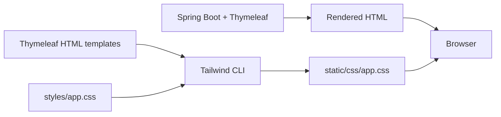

# Thymeleaf + compiled Tailwind

Thymeleaf still renders every HTML page on the Java server. Tailwind supplies
the visual styles; it does not replace controllers, DTOs, validation, or security.

## How it works



There are two separate processes: Tailwind compiles CSS during development;
Spring Boot renders HTML when someone visits a page. The browser downloads the
compiled CSS from our own application at `/css/app.css`. There is no Tailwind CDN,
JavaScript framework, or Node.js server.

## Files to understand

| File | Responsibility |
|---|---|
| `src/main/resources/templates/fragments/layout.html` | Shared document head, branding, navigation, and signup/login illustration |
| `src/main/java/com/example/fmschool/controller/LayoutAdvice.java` | Supplies the signed-in username, role and current path for navigation; does not grant permissions |
| `src/main/resources/templates/*.html` | Existing pages and their form/model bindings, with shared fragments and Tailwind classes |
| `src/main/resources/styles/app.css` | Tailwind import, explicit template scanning, theme, and reusable component styles using `@apply` |
| `src/main/resources/static/css/app.css` | Generated, minified browser stylesheet; do not edit this file directly |
| `package.json` / `package-lock.json` | Build commands and locked frontend dependencies |

The source uses Tailwind 4.3.3. Its `@source "../templates"` directive scans our
Thymeleaf files. Conditional classes use complete names such as `badge-accepted`
so Tailwind can detect them. Shared component classes keep repeated form/table
styles readable instead of copying long class lists into every page.

## Run the project normally

Run **FM School** in IntelliJ as before. The compiled CSS is committed to GitHub,
so a fresh clone already contains the stylesheet. Node.js is needed only when
changing/rebuilding styles. PostgreSQL remains the Docker service.

## Change the styling

Tested on Windows with Node.js 22.17.0 and npm 10.9.2. In the project terminal:

```powershell
npm.cmd ci
npm.cmd run css:watch
```

Keep that terminal open while editing templates or the CSS source. Open another
terminal using the **+** in IntelliJ's Terminal panel when needed. Stop the watcher
with **Ctrl+C**. Before committing:

```powershell
npm.cmd run css:build
```

If IntelliJ does not copy changed resources automatically, use **Build → Build
Project** (Ctrl+F9), then refresh the browser. Restart the application after Java
changes. Ctrl+F5 refreshes an older cached stylesheet.

Commit both the source changes and generated CSS. Keep `package-lock.json`
tracked and `node_modules/` ignored. `npm ci` reproduces the locked installation.

## Manual checks

1. Open `/login`: check readable labels, editable inputs, and signup links.
2. Open both signup forms: Student shows Roll; Teacher shows Course. Submit
   invalid data and check that the error message is visible and fields remain.
3. Sign in as a Teacher: the profile should open with the teacher navigation.
4. Open My Enrollments: check status badges, student details, and Edit Student.
5. Open an accepted student's edit page: check Name, Roll and Marks fields.
6. As Admin, check Manage Teachers, Manage Students, add/edit forms and enrollment
   management. Delete buttons still submit immediately, as requested.
7. Check the desktop/lab layout at the size used for the demonstration.
8. Use Tab to move through links/inputs: keyboard focus should remain visible.

Responsive/mobile behavior is outside the current lab scope. Do not treat
responsive utility classes that happen to exist in the compiled CSS as a
required deliverable. Run the current test command and the demo runner before
the demonstration; exact test and live-request totals can change.

References: [Tailwind CLI](https://tailwindcss.com/docs/installation/tailwind-cli)
and [source scanning](https://tailwindcss.com/docs/detecting-classes-in-source-files).
